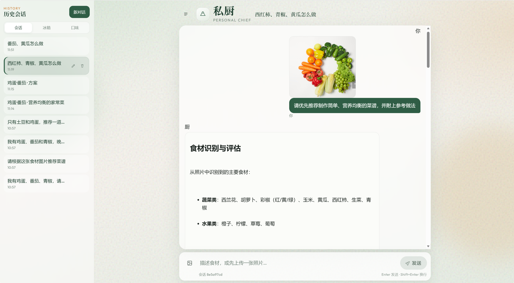
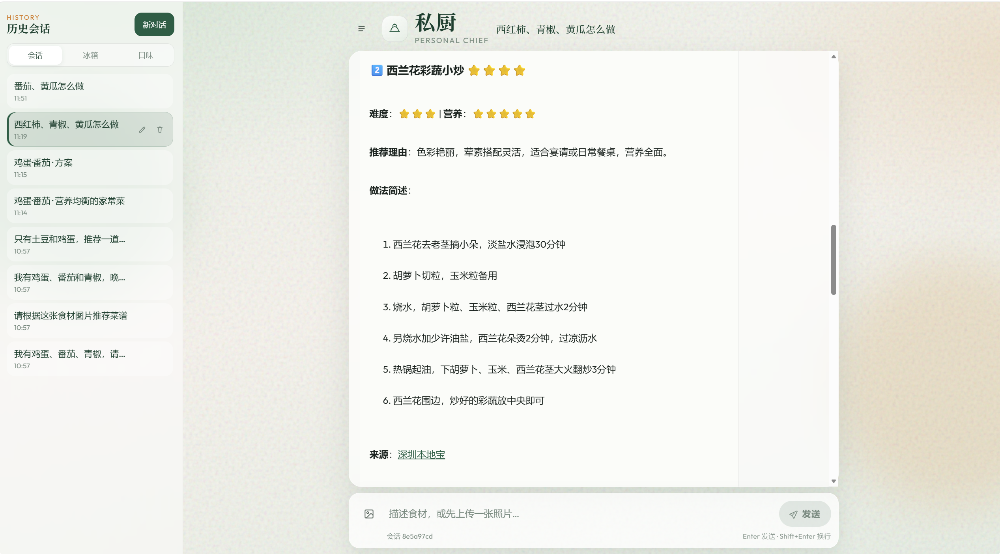

# 2. 基于 LangChain 的私厨助手

技术栈：Python / FastAPI / LangChain / LangGraph / FastMCP / Tavily / SQLite / 阿里云 OSS / SSE

- 实现「看图识食材 → 写入冰箱库存 → 联网搜菜谱 → 按营养与难度推荐」端到端 Agent；多模态模型识别食材并评估新鲜度，忌口与过敏作为硬约束。
- 全部工具以 FastMCP 部署（库存 upsert/list/remove、口味档案读写、Tavily `web_search`），经 LangChain `MCPAdapter` 接入 Agent；优先检索真实菜谱，失败再由模型补全，按营养价值、制作难度打分排序并结构化输出。
- FastAPI + SSE 实现流式对话、多会话切换、随时停止生成；LangGraph + SQLite 按会话持久化，支持多轮追问。冰箱库存与口味档案落在同一库中、跨会话生效，每轮注入「长期档案 / 当前库存」。
- 图片经阿里云 OSS 预签名直传；菜谱参考图走服务端代理规避防盗链；侧边栏提供会话 / 冰箱 / 口味面板，可手改库存与忌口。

---

## 系统界面

### 看图识食材

上传冰箱照片后识别蔬菜水果并评估新鲜度；左侧为历史会话，可切换「会话 / 冰箱 / 口味」。



### 菜谱推荐

按制作难度与营养价值打分，给出做法要点与来源链接。



---

## 架构

```
看图 / 口述食材 / 改口味
        ↓
FastAPI + SSE
        ↓
LangChain Agent（每轮注入档案 + 库存）
        ↓
FastMCP 工具
  ├─ pantry_* / profile_*  → SQLite
  └─ web_search            → Tavily
        ↓
结构化菜谱推荐（带来源链接）
```

同一份 `app/db/personal_chief.db`：

| 存储 | 职责 | 清聊天是否丢失 |
| --- | --- | --- |
| LangGraph checkpoint + `chat_threads` | 本会话对话 | 会 |
| `pantry_items` / `user_profile` | 冰箱与口味（跨会话） | 不会 |

---

## 环境与启动

Python ≥ 3.13，推荐 [uv](https://github.com/astral-sh/uv)。仓库根目录配置 `.env`：

```env
DASHSCOPE_API_KEY=sk-xxxxxxxx
DASHSCOPE_BASE_URL=https://dashscope.aliyuncs.com/compatible-mode/v1
TAVILY_API_KEY=tvly-xxxxxxxx
# 上传图片时再配 OSS_*
```

```bash
uv sync

# Windows 中文路径请用这一条，避免 uv trampoline 失败
uv run python -m uvicorn app.main:app --host 127.0.0.1 --port 8001

# 仅以 stdio 暴露 MCP 服务器
uv run python -m app.mcp
```

- 前端：http://127.0.0.1:8001/
- API 文档：http://127.0.0.1:8001/docs

日志出现 `已接入 MCP 工具: ['pantry_upsert', ... 'web_search']` 即表示工具已挂上 Agent。

---

## 目录

```
app/
├── main.py                 # FastAPI：lifespan 接入 MCP Agent
├── agents/personal_chief.py
├── mcp/server.py           # FastMCP 工具
├── api/v1/                 # chat / memory / oss / proxy
├── db/store.py             # 库存与档案
└── static/                 # 会话 / 冰箱 / 口味界面
```

本包以 `app` 形式导入，请在含 `pyproject.toml` 的仓库根目录安装并启动。

---

## 主要 API

| 方法 | 路径 | 说明 |
| --- | --- | --- |
| `POST` | `/api/v1/chat/stream` | SSE 流式对话 |
| `GET` / `DELETE` | `/api/v1/chat/messages` | 会话历史 / 清空检查点 |
| `GET` / `PATCH` / `DELETE` | `/api/v1/threads` | 会话目录 |
| `GET` / `POST` | `/api/v1/pantry` | 库存列表 / 手加 |
| `POST` | `/api/v1/pantry/remove` | 移除库存 |
| `GET` / `PUT` | `/api/v1/profile` | 口味档案 |
| `GET` | `/api/v1/oss/presign` | OSS 预签名上传 |
| `GET` | `/api/v1/proxy/image` | 外链图片代理 |

---

## 注意

- 勿将 `.env` 与密钥提交到仓库；`app/db/*.db` 建议 gitignore。
- 照片里未出现的食材不会自动删除，避免误清抽屉。
- 清空会话只清聊天，不清冰箱和档案。
